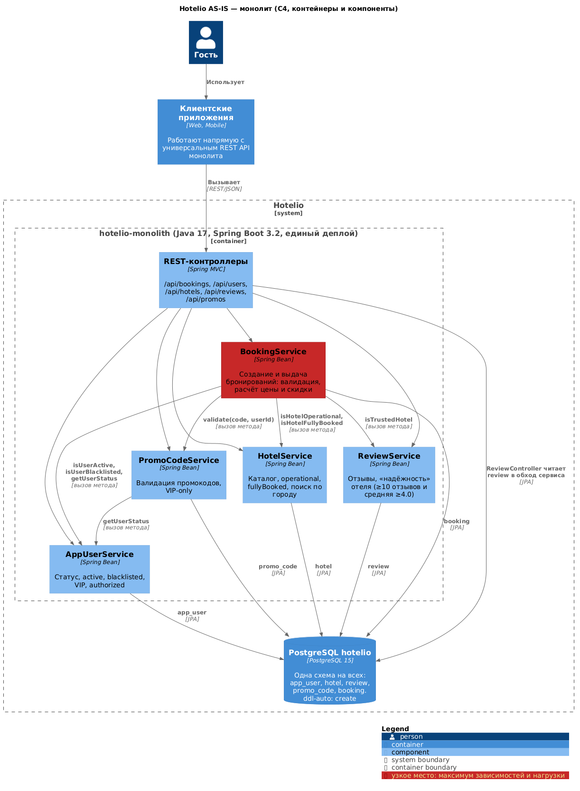
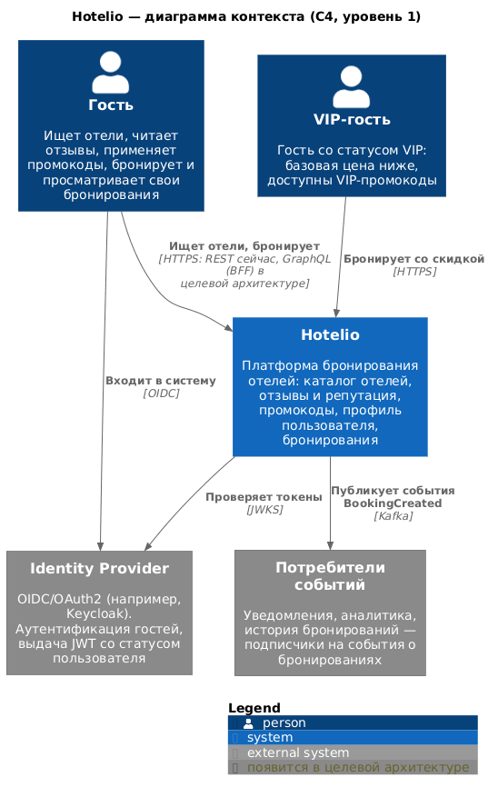
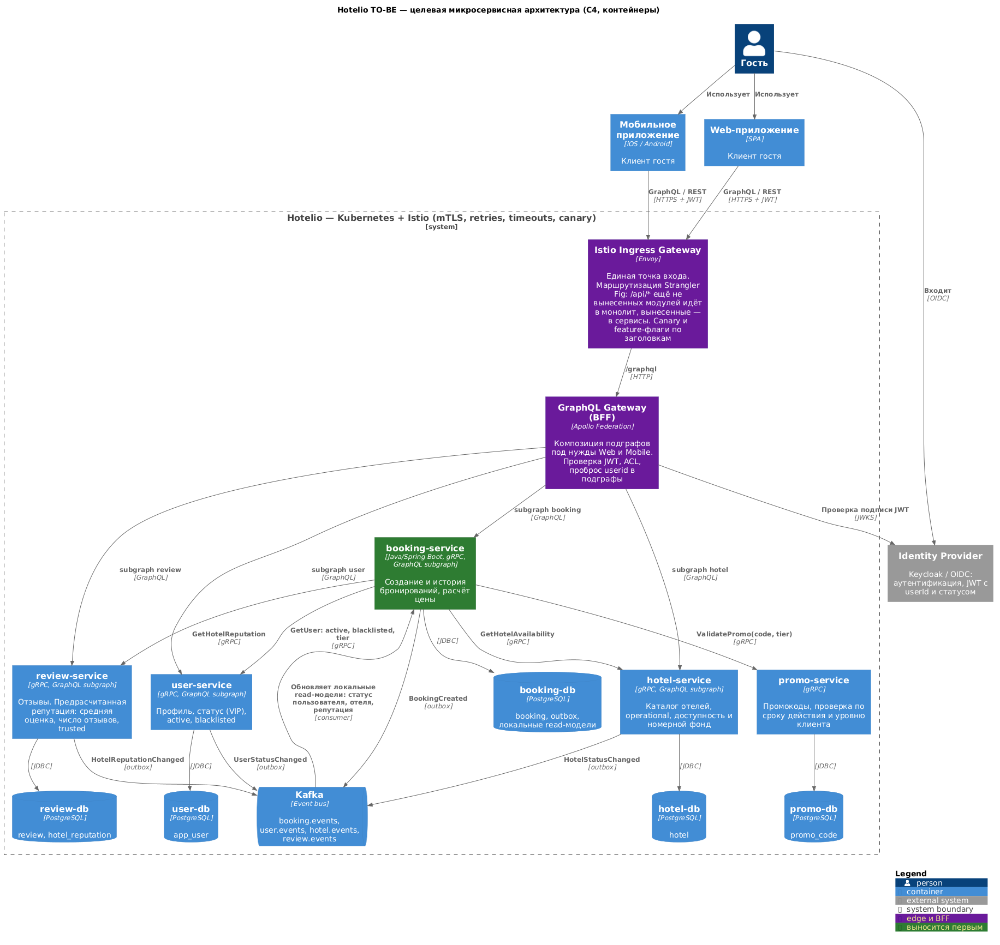
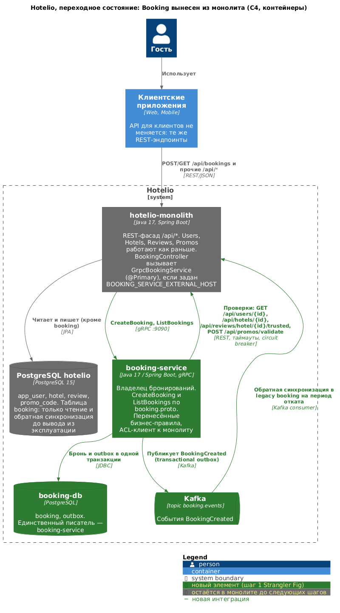
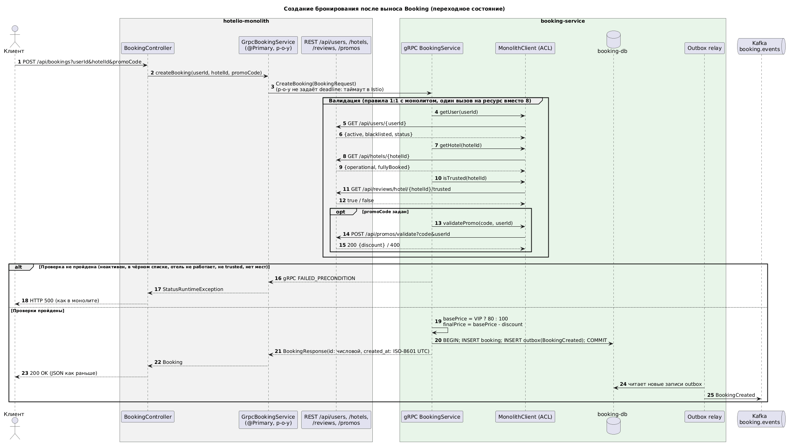

# ADR-001. Миграция Hotelio с монолита на микросервисы

### **Название задачи:**
Миграция Hotelio от монолита к микросервисам: целевая архитектура и план первого шага — вынос модуля Booking по паттерну Strangler Fig.

### **Автор:**
Alexandr Lipnitsky

### **Дата:**
24.10.2026

**Статус:** предложено.

> **Кратко.** Целевое состояние — доменные сервисы (booking, hotel, review, promo, user), у каждого своя БД. Синхронные вызовы между ними идут по gRPC, асинхронные события — через Kafka и transactional outbox. Внешний вход — Istio Ingress и GraphQL Federation (BFF), всё работает в Kubernetes. Миграцию **начинаем с Booking**. Его не вызывает ни один модуль монолита. Все его зависимости — проверки только на чтение, и они уже доступны через REST. Его таблица изолирована. В монолит уже встроен шов `GrpcBookingService`, который включается переменной окружения. При этом Booking несёт пиковую нагрузку и сильнее всех нуждается в независимом масштабировании.

---

### **Функциональные требования**

Ниже use cases текущей системы (UC-1…UC-6, поведение подтверждено кодом и регрессионными тестами) и новые сценарии, которые появляются в целевой архитектуре (UC-7…UC-9).

|**№**|**Действующие лица или системы**|**Use Case**|**Описание**|
| :-: | :- | :- | :- |
|UC-1|Гость, клиентское приложение; Booking, User, Hotel, Review, Promo|Создать бронирование|1. Клиент передаёт `userId`, `hotelId` и необязательный `promoCode`. 2. Пользователь должен быть активен и не находиться в чёрном списке. 3. Отель должен работать (`operational`). 4. Отель должен быть «надёжным»: не меньше 10 отзывов и средняя оценка от 4.0. 5. В отеле должны быть места (`fullyBooked = false`). 6. Базовая цена: 80 для VIP, 100 для остальных. 7. Если промокод не истёк и подходит пользователю (VIP-only — только VIP), скидка вычитается из цены. 8. Бронь сохраняется и возвращается клиенту. Если не выполнен любой из шагов 2–5, бронирование отклоняется.|
|UC-2|Гость, клиентское приложение; Booking|Просмотреть бронирования|1. Клиент запрашивает `GET /api/bookings` с `userId` или без него. 2. Система возвращает брони пользователя или все брони.|
|UC-3|Клиентское приложение, Booking, Promo; User|Получить профиль и статусы пользователя|1. Запрос профиля по `userId`. 2. Отдельные проверки: `status`, `active`, `blacklisted`, `vip`, `authorized` (= active и не в чёрном списке).|
|UC-4|Гость, клиентское приложение, Booking; Hotel|Найти отель и проверить его состояние|1. Получить отель по `id`. 2. Найти отели в городе. 3. Получить топ-N отелей города по рейтингу. 4. Проверить `operational` и `fully-booked`.|
|UC-5|Гость, Booking; Review|Посмотреть отзывы и надёжность отеля|1. Получить отзывы отеля. 2. Рассчитать «надёжность»: от 10 отзывов и средняя оценка от 4.0.|
|UC-6|Гость, Booking; Promo, User|Проверить промокод|1. Получить промокод по коду. 2. Проверить применимость с учётом VIP-статуса (`/valid?isVipUser=`). 3. Проверить для конкретного пользователя (`/validate?code&userId`); статус берётся у User.|
|UC-7 *(новый)*|Web- и Mobile-клиенты; GraphQL Gateway (BFF), booking- и hotel-подграфы|Получить агрегированные данные одним запросом|1. Клиент отправляет GraphQL-запрос `bookingsByUser` с вложенными данными отеля. 2. Gateway проверяет пользователя (JWT, на переходном этапе заголовок `userid`) и применяет ACL. 3. Booking-подграф возвращает брони, hotel-подграф дополняет их данными отелей. 4. Чужие брони не возвращаются.|
|UC-8 *(новый)*|booking-service, Kafka, потребители (уведомления, аналитика, история, обратная синхронизация)|Опубликовать событие о новом бронировании|1. Бронь и запись outbox сохраняются в одной транзакции. 2. Outbox relay публикует `BookingCreated` в `booking.events`. 3. Потребители обрабатывают событие идемпотентно по `bookingId`.|
|UC-9 *(новый, на период миграции)*|Оператор/DevOps; hotelio-monolith, booking-service|Переключить бронирование на новый сервис и откатить|1. На экземплярах монолита задаётся `BOOKING_SERVICE_EXTERNAL_HOST/PORT`. 2. `GrpcBookingService` (`@Primary`) подменяет локальный `BookingService`. 3. `/api/bookings` проксируется в booking-service по gRPC; клиенты изменений не видят. 4. Откат — снять переменную и перезапустить экземпляры.|

### **Нефункциональные требования**

|**№**|**Требование**|
| :-: | :- |
|НФТ-1|**Независимое масштабирование.** Бронирование масштабируется горизонтально при пиковых нагрузках отдельно от остального функционала (проблема 2 из `context.md`).|
|НФТ-2|**Независимая разработка и деплой.** У каждого сервиса свой пайплайн CI/CD (build → test → deploy → tag) и свой релизный цикл (проблемы 1, 3).|
|НФТ-3|**Обратная совместимость.** Во время миграции публичный REST API не меняется: пути, параметры, формат JSON, коды ответов. `test/regress.sh` проходит на каждом этапе.|
|НФТ-4|**Миграция без простоя.** Переключение и откат занимают минуты и не требуют пересборки: переменная окружения или feature-флаг, canary 10 % → 50 % → 100 %.|
|НФТ-5|**Отказоустойчивость.** У всех межсервисных вызовов есть deadline. Ретраи — только для идемпотентных операций и с бюджетом. Есть circuit breaker и понятная деградация при недоступности зависимостей.|
|НФТ-6|**Производительность** (целевые значения — предложение, согласуются с бизнесом). Создание брони: p95 ≤ 300 мс. Чтение списка: p95 ≤ 150 мс. Деградация p95 после выноса — не более 20 % от базовой линии монолита.|
|НФТ-7|**Целостность данных.** Бронь атомарна внутри booking-service. Между сервисами допускается eventual consistency (секунды). События о бронях не теряются: transactional outbox, at-least-once, идемпотентные потребители.|
|НФТ-8|**Владение данными.** У каждого сервиса своя БД. Прямой доступ к чужим таблицам запрещён, данные доступны только через API или события.|
|НФТ-9|**Сохранность данных.** Схема управляется миграциями (Flyway), а не `ddl-auto: create`. Рестарт сервиса не приводит к потере данных.|
|НФТ-10|**Безопасность.** Аутентификация через OIDC/JWT вместо `userId` в параметрах запроса. ACL в BFF и сервисах. mTLS между сервисами.|
|НФТ-11|**Наблюдаемость.** Сквозная трассировка (OpenTelemetry, trace-id от gateway до сервисов), RED-метрики, централизованные логи, liveness- и readiness-пробы.|
|НФТ-12|**Поддержка разных клиентов.** Web и Mobile получают данные в нужной форме за один запрос (BFF на GraphQL), без изменений в доменных сервисах (проблема 4).|
|НФТ-13|**Ограниченные ресурсы.** Миграция идёт по одному модулю. Используются технологии, уже присутствующие в стеке: Java/Spring Boot, PostgreSQL, gRPC, Kafka.|

---

### **Решение**

#### 1. Текущее состояние (AS-IS)

Hotelio — один Spring Boot-сервис (Java 17) с одной PostgreSQL-схемой. Модули вызывают друг друга напрямую через методы. Анализ зависимостей по коду:

| Модуль | Кто от него зависит (входящие) | От кого зависит (исходящие) | Данные |
| :- | :- | :- | :- |
| `BookingService` | никто, только `BookingController` | User (3 метода), Hotel (2), Review (1), Promo (1) | `booking`, используется только им, без FK |
| `AppUserService` | Booking, Promo | — | `app_user` |
| `HotelService` | Booking | — | `hotel` |
| `ReviewService` | Booking | — | `review` (ещё и `ReviewController` напрямую через репозиторий) |
| `PromoCodeService` | Booking | User | `promo_code` |

Booking — «сток» графа: он зависит от всех, а от него не зависит никто. User — «исток»: от него зависят Booking и Promo.

**Проверка на стенде.** Монолит поднят из `tasks/task1`, регрессионные тесты `test/regress.sh` прошли полностью (29/29). Для запуска понадобились две правки окружения (см. П-14). Полный лог — [test-log.txt](test-log.txt): регресс, анализ кодовой базы и API-проверки проблем из раздела 2. Повторить его можно командой `tasks/task1/run-checks.sh`.

#### 2. Ключевые проблемы

**2.1. Архитектурные проблемы** (из бизнес-контекста, подтверждены кодом)

| № | Проблема | Где видно | Решение в целевой архитектуре |
| :-: | :- | :- | :- |
|П-1|Сильная связанность. Бронирование напрямую вызывает 4 модуля, Promo — модуль User. Изменения расходятся каскадом|`BookingService`, `PromoCodeService`|Сервисы по доменам с явными контрактами (gRPC proto). Promo получает уровень клиента параметром и не ходит в User|
|П-2|Общая БД и общая схема, у данных нет владельца|`application.yml`, единая схема `hotelio`|Database per service, доступ к данным только через API или события|
|П-3|`ddl-auto: create`: при **каждом старте схема удаляется и создаётся заново, все данные теряются**|`application.yml`, в логах старта `drop table if exists … cascade` / `create table …`|Flyway-миграции, `ddl-auto: validate`. Исправляется на этапе 0, до начала миграции|
|П-4|Нельзя масштабировать только бронирование, единый деплой и релизный цикл|один jar, один контейнер|Отдельный booking-service, HPA в Kubernetes, CI/CD для каждого сервиса|
|П-5|REST API универсальный и «болтливый». Отдельные эндпоинты на каждый флаг (`/active`, `/blacklisted`, `/vip`, `/authorized`). JPA-сущности отдаются наружу как DTO, нет версий API и пагинации (`GET /api/bookings` → `findAll`). Нет BFF|контроллеры|GraphQL Federation как BFF, DTO вместо сущностей, версионирование (v2) и пагинация в новых API|
|П-6|Нет аутентификации. `userId` приходит параметром, поэтому любой может забронировать от чужого имени. `/authorized` — это флаг, а не авторизация|`BookingController`, `AppUserController`|IdP (OIDC/JWT), ACL в BFF, mTLS в mesh|
|П-7|Нет наблюдаемости и автотестов. `show-sql: true`, нет health-проб и метрик. Тестов в кодовой базе нет, только внешний регресс|`application.yml`, репозиторий|OpenTelemetry, Prometheus, пробы. Регресс и контрактные тесты в CI|

**2.2. Проблемы, найденные в коде и проверенные на запущенном стенде**

| № | Проблема | Подтверждение | Что делаем |
| :-: | :- | :- | :- |
|П-8|Поле `discountPercent` хранит **абсолютную** скидку, а цена считается как `база − скидка`. Для VIP с промокодом на 20 % получается 60 вместо 64|`POST /api/bookings?userId=test-user-3&hotelId=test-hotel-1&promoCode=TESTCODE-VIP` → `"discountPercent":20.0,"price":60.0`|В booking-service переносим 1:1, чтобы не сломать совместимость. Исправляем в API v2 после переключения, по решению бизнеса|
|П-9|`createdAt` никогда не заполняется|в ответе на создание брони `"createdAt":null`|booking-service заполняет его в UTC (ISO-8601). Изменение совместимо: раньше там был `null`|
|П-10|`validUntil` у промокода игнорируется, проверяется только флаг `expired`|промокод с `valid_until = 2020-01-01` и `expired = false` → `GET /api/promos/{code}/valid` = `true`|Исправляется в promo-service при его выносе. До этого фиксируем как известный дефект|
|П-11|Неприменимый промокод молча игнорируется, но сохраняется в брони|`promoCode=NOPE` → бронь с `"promoCode":"NOPE","discountPercent":0.0`|1:1 на переходном этапе, в v2 — явная ошибка валидации|
|П-12|Все бизнес-ошибки возвращаются как HTTP 500 без описания (`IllegalArgumentException` без обработчика). Несуществующий пользователь или отель трактуется как «неактивен» или «не работает»|`userId=ghost` → `500 Internal Server Error`|Переходный период: сохраняем 500 (этого ждут тесты). v2: 404, 409, 422 и тело ошибки|
|П-13|Лишние обращения к данным. За одно бронирование пользователь читается до 4 раз, отель — 2 раза. В монолите это маскирует кэш Hibernate (Open Session in View): на стенде 5 SQL-запросов. При «наивном» выносе это превратится в **8 сетевых вызовов**. «Надёжность» считается загрузкой **всех** отзывов отеля в память, и поле `hotel.rating` не связано с отзывами (два источника рейтинга)|`BookingService`, `ReviewService`, лог SQL|ACL-клиент делает 4 вызова (по одному на ресурс). В целевом состоянии репутация предрасчитана в review-service, а booking-service держит локальные read-модели|
|П-14|Сборка окружения сломана из-за устаревших базовых образов: `openjdk:17-jdk-slim` удалён с Docker Hub, а у `debian:bullseye-slim` закончилась поддержка (404 на security-пакетах)|`docker compose up` зависал, сборка `test/` падала|Уже исправлено: `eclipse-temurin:17-jre` (`tasks/monolith/Dockerfile`), `debian:bookworm-slim` (`test/Dockerfile`). Дальше — фиксировать digest и обновлять образы через Renovate|
|П-15|Цена не зависит от отеля и дат: 100/80 захардкожены, у брони нет дат заезда и выезда. `fullyBooked` — статичный флаг, не связанный с бронями. Проверка и запись идут не в одной транзакции, поэтому возможен овербукинг|`BookingService`, `Hotel`|Номерной фонд и доступность — зона hotel-service. Отдельный ADR после выноса Booking|
|П-16|Документация расходится с кодом. В `readme.md` есть `name`, `pricePerNight`, `bookingId`, `finalPrice`, `comment`, а в сущностях их нет (`id`, `price`, `text`). `ReviewController` обходит сервисный слой|`architecture/readme.md`, контроллеры|Контракт задаётся proto- и GraphQL-схемами, документация генерируется из них|

#### 3. Целевая архитектура (TO-BE)

**3.1. Диаграмма контекста**

**3.2. Диаграмма контейнеров**

**3.3. Декомпозиция на сервисы**

Границы сервисов совпадают с границами существующих модулей. Это ограниченные контексты, и между таблицами нет внешних ключей, поэтому декомпозиция естественная.

| Сервис | Ответственность | Данные | API | Публикует |
| :- | :- | :- | :- | :- |
| booking-service | Создание и история бронирований, расчёт цены | `booking`, `outbox`, read-модели | gRPC (`booking.proto`), GraphQL-подграф | `BookingCreated` |
| hotel-service | Каталог, `operational`, доступность (позже номерной фонд) | `hotel` | gRPC, GraphQL-подграф | `HotelStatusChanged` |
| review-service | Отзывы, предрасчитанная репутация (средняя, количество, `trusted`) | `review`, `hotel_reputation` | gRPC, GraphQL-подграф | `HotelReputationChanged` |
| promo-service | Промокоды, проверка по сроку и уровню клиента (`ValidatePromo(code, tier)`) | `promo_code` | gRPC | — |
| user-service | Профиль, статус/уровень (VIP), `active`, `blacklisted` | `app_user` | gRPC, GraphQL-подграф | `UserStatusChanged` |
| GraphQL Gateway (BFF) | Композиция подграфов для Web и Mobile, проверка JWT, ACL | — | GraphQL | — |

**3.4. Интеграции и выбор технологий**

- **Вход для клиентов — Istio Ingress Gateway и Apollo Federation (GraphQL BFF).**
  - Закрывает проблему 4: клиенты сами выбирают состав данных, а каждая команда владеет своим подграфом.
  - Ingress выполняет роль фасада Strangler Fig: ещё не вынесенные `/api/*` идут в монолит, вынесенные — в сервисы.
  - REST сохраняется для обратной совместимости.
- **Синхронно между сервисами — gRPC.**
  - Контракт фиксируется в proto, клиенты генерируются, протокол бинарный, есть deadline и коды статусов.
  - В монолит уже встроен gRPC-клиент для Booking (`p-o-y`, `booking.proto`), поэтому стек проверен.
  - Синхронные вызовы нужны только там, где ответ требуется прямо сейчас: проверки при создании брони.
- **Асинхронно — Kafka и transactional outbox.**
  - События публикуются в той же транзакции, что и данные, без dual write.
  - По событиям booking-service строит локальные read-модели (статус пользователя, отеля, репутация) и постепенно уходит от синхронных проверок.
  - Kafka уже есть в окружении (`tasks/task2/docker-compose.yml`).
- **Данные — PostgreSQL для каждого сервиса, Flyway.** Команда уже владеет этой СУБД, отдельные БД исключают связность через схему.
- **Развёртывание — Kubernetes и Helm, GitLab CI для каждого сервиса.**
  - Единообразный деплой, пробы, HPA для booking-service.
  - Отдельные values для staging и prod.
- **Service mesh — Istio.** mTLS, таймауты, ретраи, circuit breaking (outlier detection), canary по весам, маршрутизация по заголовку как feature-флаг, fallback.
- **Безопасность — IdP (Keycloak, OIDC).**
  - JWT содержит `userId` и уровень клиента (`tier`).
  - Promo получает `tier` параметром и не зависит от User. Такой эндпоинт уже есть: `/api/promos/{code}/valid?isVipUser=`.
- **Наблюдаемость.** OpenTelemetry (трейсы от gateway до сервисов и Kafka), Prometheus и Grafana, централизованные логи.

#### 4. Выбор первого модуля: Booking

**4.1. Сравнение кандидатов**

| Критерий | **Booking** | Hotel | Review | Promo | User |
| :- | :- | :- | :- | :- | :- |
| Ценность и пиковая нагрузка (`context.md`) | **высокая**, основной сценарий, нагрузка названа явно | средняя (поиск) | низкая | низкая | средняя |
| Входящие зависимости (что сломается в монолите) | **0** | 1 (Booking) | 1 (Booking) | 1 (Booking) | 2 (Booking, Promo) |
| Исходящие зависимости | 4, **только чтение**, все уже есть в REST монолита | 0 | 0 | 1 (User) | 0 |
| Изоляция данных | `booking` используется только им, нет FK, append-only | `hotel` | `review`, но контроллер ходит в репозиторий | `promo_code` | `app_user` |
| Готовый шов для переключения | **есть**: `GrpcBookingService` (`@Primary`) и `booking.proto` | нет | нет | нет | нет |
| Какие проблемы из `context.md` закрывает | масштабирование, автономия ключевого домена, события | частично | почти никакие | никакие | частично |
| Риск выноса | средний: ключевой поток, но откат одной переменной | низкий | низкий | низкий | **высокий**: от него зависят все, плюс безопасность |

**4.2. Почему Booking, хотя он самый связанный**

1. **Это «сток» графа зависимостей.** В монолите Booking никто не вызывает, кроме собственного контроллера. Вынос не ломает ни один модуль, а монолит обращается к Booking через единственный шов.
2. **Все исходящие зависимости — чтения.** Это проверки, и они уже доступны через REST монолита: `/api/users/{id}`, `/api/hotels/{id}`, `/api/reviews/hotel/{id}/trusted`, `/api/promos/validate`. Контракт для ACL-клиента уже существует. Писать в монолит не нужно, распределённые транзакции и саги не нужны.
3. **Данные отделяются чисто.** Таблицу `booking` использует только `BookingRepository`, внешних ключей нет. Брони только добавляются: в коде нет update и delete, поэтому перенос и догоняющая синхронизация сводятся к копированию по `id`.
4. **Шов уже встроен.** Библиотека `p-o-y` регистрирует `GrpcBookingService` как `@Primary` по условию `BOOKING_SERVICE_EXTERNAL_HOST`. Переключение и откат делаются конфигурацией, без пересборки монолита.
5. **Максимальная отдача.** Решаются главные боли: пиковая нагрузка на бронирование, независимое масштабирование, автономия команды для самых изменчивых правил (цена, скидки). Появляется поток событий для новых фич.
6. **Получаем шаблон платформы.** gRPC, outbox и Kafka, своя БД, Helm, CI/CD, Istio — всё это затем повторяется для остальных модулей.

**4.3. Почему не другие модули**

- **Review или Hotel.** Их вынос проще, но он не решает ни одной проблемы из `context.md`. Booking останется в монолите и будет ходить к ним по сети: сетевые издержки появятся, а выгоды не будет.
- **User.** Риск максимальный: от него зависят Booking и Promo, плюс аутентификация. Его выносим последним, вместе с внедрением IdP.
- **Promo.** Маленький модуль с низкой ценностью, к тому же зависит от User.

#### 5. План миграции по Strangler Fig

**5.1. Переходное состояние после выноса Booking**

**5.2. Этапы**

| Этап | Что делаем | Критерий перехода | Откат |
| :-: | :- | :- | :- |
|0. Подготовка монолита|1. Заменить `ddl-auto: create` на Flyway-baseline и `validate` (П-3). 2. Встроить `test/regress.sh` в CI как приёмочный тест. 3. Снять базовую линию метрик `/api/bookings`: RPS, p95, error rate. Добавить trace-id. 4. Заморозить изменения бизнес-логики в `BookingService` монолита. 5. Объявить REST-эндпоинты users, hotels, reviews и promos «замороженным» контрактом для ACL.|Регресс зелёный, есть базовая линия|Не требуется|
|1. booking-service без трафика|1. Новый сервис на Java 17 и Spring Boot: gRPC по `booking.proto` (`CreateBooking`, `ListBookings`), своя `booking-db` (`booking`, `outbox`), Flyway. 2. Перенести правила 1:1, включая П-8, П-11, П-12. 3. ACL-клиент к REST монолита: 4 вызова, deadline, ретраи только для GET, circuit breaker. 4. Docker, Helm, CI/CD, деплой в staging.|Unit- и контрактные тесты. Регресс зелёный на staging с включённым прокси|Сервис не получает трафик|
|2. Перенос данных|1. Снимок `booking` → `booking-db`. 2. Последовательность ID в booking-service начинается с отдельного диапазона (например, от 10 000 000), чтобы не пересекаться с монолитом во время canary. 3. Догоняющая инкрементальная синхронизация монолит → `booking-db` по `last_id < id < 10 000 000` с `ON CONFLICT DO NOTHING` (брони только добавляются). Строки, которые обратная синхронизация записала в legacy-таблицу, назад не копируются. 4. Сверка количества и контрольных сумм.|Расхождений 0|Монолит остаётся источником истины|
|3. Переключение (canary)|1. Задать `BOOKING_SERVICE_EXTERNAL_HOST/PORT` на части экземпляров монолита: 10 % → 50 % → 100 %. 2. Обратная синхронизация: потребитель `BookingCreated` пишет брони в legacy-таблицу `booking` с тем же `id`, чтобы ещё не переключённые экземпляры и откат видели все брони.|Регресс зелёный, error rate и p95 в пределах НФТ-6, расхождений 0|Снять переменную окружения. Благодаря обратной синхронизации данные не теряются|
|4. События|1. `BookingCreated` публикуется через outbox в `booking.events`. 2. Подключаются потребители: уведомления, аналитика, история. Идемпотентность по `bookingId`.|События доставляются, дублей не видно в бизнес-метриках|Отключить потребителей|
|5. Вывод из монолита|1. Маршрут `/api/bookings` на ingress переводится прямо на booking-service (REST-фасад и GraphQL-подграф), монолит выходит из цепочки. 2. После периода стабилизации удалить `BookingService`, `BookingRepository`, сущность и таблицу `booking`, обратную синхронизацию и `p-o-y`. 3. Booking-подграф подключить к GraphQL BFF.|N дней нет обращений к legacy `booking`|До удаления кода — вернуть маршрут на монолит|
|6. Следующие модули|По тому же шаблону: **Review** (предрасчитанная репутация) → **Hotel** (доступность и номерной фонд) → **Promo** (`ValidatePromo(code, tier)`, исправление П-10) → **User** (вместе с IdP). Для booking-service меняется только адаптер ACL: адрес и протокол зависимостей, бизнес-код не трогается|По каждому модулю — свой ADR|Свой для каждого шага|

**5.3. Контракт совместимости booking-service с прокси монолита**

Прокси `GrpcBookingService` превращает `BookingResponse` обратно в сущность `Booking`. Из этого следуют ограничения:

- `id` — числовая строка. Прокси делает `Long.parseLong`, поэтому UUID не подходит.
- `created_at` — ISO-8601 с часовым поясом, например `2026-10-24T16:03:54Z`. Прокси делает `Instant.parse`.
- `discount_percent` на переходном этапе хранит абсолютную скидку (П-8), `promo_code` сохраняется в том виде, в каком передан (П-11).
- Ошибка валидации возвращается любым gRPC-статусом, кроме `OK` (рекомендуется `FAILED_PRECONDITION`). Монолит отдаст HTTP 500, как ожидают тесты.
- Ответы ACL трактуются так:
  - `404` для пользователя → «неактивен», бронь отклоняется;
  - `404` для отеля → «не работает», отклоняется;
  - `400` от `/promos/validate` → скидка 0.
- Пустой `user_id` в `ListBookings` → вернуть все брони, как `listAll(null)`. Проверить в задании 2: прокси может вызвать `setUserId(null)` для `GET /api/bookings` без `userId`, а protobuf на `null` бросает NPE.

---

### **Альтернативы**

| Альтернатива | Плюсы | Минусы | Решение |
| :- | :- | :- | :- |
|**Big Bang**: переписать систему целиком|Сразу чистая архитектура|Долго, бизнес ждёт, высокий риск, нет обратной связи|Отклонено|
|**Модульный монолит**: разделить модули и схемы, оставить один деплой|Дёшево, нет сетевых издержек|Не решает независимое масштабирование и деплой (проблемы 2, 3)|Отклонено как цель. Разделение границ модулей полезно как подготовка|
|**Начать с листового модуля** (Review или Hotel)|Проще и безопаснее|Не закрывает проблемы `context.md`, Booking остаётся узким местом|Отклонено (п. 4.3)|
|**Начать с User**|Сразу решить аутентификацию|Максимальный радиус поражения: от User зависят все|Отклонено, User выносим последним|
|**Общая БД** монолита и booking-service на переходный период|Не нужно переносить данные|Связность через схему, нельзя менять схему независимо, общие ресурсы БД, разделять всё равно придётся позже|Отклонено|
|**Переключение сразу на ingress** (`/api/bookings` → REST booking-service) вместо gRPC-прокси в монолите|Монолит не участвует в запросе|Сервису с первого дня нужно 1:1 повторять REST-контракт, сериализацию и формат ошибок. Шов в монолите уже готов|На первом шаге — прокси в монолите, ingress — на этапе 5|
|**REST вместо gRPC** между новыми сервисами|Проще отлаживать|Нет строгого контракта и генерации клиентов, дороже по ресурсам|gRPC между новыми сервисами. REST — только для вызовов в монолит, пока он есть|
|**Только асинхронная интеграция** с первого шага (read-модели вместо синхронных проверок)|Нет runtime-зависимости от монолита|Монолит не публикует события, нужен CDC. Окно рассогласования: бронь может пройти для только что заблокированного пользователя|Целевое направление. Вводим после выноса User, Hotel и Review|
|**REST-BFF для каждой платформы** вместо GraphQL Federation|Простота, полный контроль на сервере|Отдельный BFF на каждую платформу, дублирование кода агрегации|GraphQL Federation. REST-BFF — если для какой-то платформы GraphQL окажется избыточным|

### **Недостатки, ограничения, риски**

**Недостатки**

- **Растёт операционная сложность.** Kubernetes, Istio, Kafka и несколько БД требуют компетенций, мониторинга и бюджета.
- **Сетевые вызовы вместо вызовов методов.** Создание брони требует 4 межсервисных вызова: растёт латентность, появляются частичные отказы.
- **Eventual consistency между сервисами и нет JOIN между доменами.** Решается через BFF и read-модели, но усложняет разработку.
- **Логика бронирования временно дублируется** в монолите и в сервисе (до этапа 5). Дисциплина «заморозки» обязательна.

**Ограничения**

- **Публичный REST API и известные дефекты (П-8, П-11, П-12) сохраняются** до выпуска v2. Совместимость важнее исправлений.
- **На переходном этапе booking-service зависит от доступности монолита.** Для бронирования монолит остаётся точкой отказа.
- **Прокси `p-o-y` переключает `createBooking` и `listAll` одновременно.** Отдельно перевести только чтение нельзя. Контракт тоже жёсткий: числовой `id`, ISO-8601.
- **Прокси `p-o-y` не задаёт deadline для gRPC-вызовов.** Если booking-service зависнет, он заблокирует потоки монолита. Таймаут нужно задать в Istio (`timeout` в VirtualService) и внутри booking-service.
- **Проблема безопасности (П-6) не решается на первом шаге.** Пока нет IdP, ACL в BFF опирается на заголовок `userid`, и это временная мера.

**Риски**

| № | Риск | Вероятность | Влияние | Митигация |
| :-: | :- | :-: | :-: | :- |
|R-1|Растёт латентность и падает доступность бронирования из-за сетевых вызовов к монолиту|средняя|высокое|Deadline, параллельные проверки, circuit breaker, короткий кэш справочных данных, HPA, нагрузочный тест до canary|
|R-2|Данные в legacy `booking` и `booking-db` расходятся при canary или откате|средняя|высокое|Append-only, разнесённые диапазоны ID, догоняющая и обратная синхронизация, автоматическая сверка|
|R-3|Поведение booking-service отличается от монолита|средняя|высокое|`test/regress.sh` в CI, контрактные тесты proto, сравнение ответов на staging, перенос правил 1:1|
|R-4|События теряются или дублируются|низкая|среднее|Transactional outbox, at-least-once, идемпотентные потребители|
|R-5|Каскадные отказы и retry storm|средняя|высокое|Ретраи только для GET и с бюджетом, outlier detection в Istio, rate limiting, fallback|
|R-6|Изменения в монолите ломают REST-контракт, на который опирается ACL|средняя|среднее|Контракт заморожен, consumer-driven contract tests (Pact)|
|R-7|Монолит теряет данные при рестарте (`ddl-auto: create`)|высокая|критическое|Исправить на этапе 0, до любых переносов данных|
|R-8|Команде не хватает компетенций и ресурсов на новую платформу|средняя|среднее|Начинаем с одного сервиса, переиспользуемые шаблоны Helm и CI, обучение на первом сервисе|
|R-9|Гонка при проверке: пользователя заблокировали или отель закрылся во время бронирования|низкая|низкое|Риск есть и в монолите (нет транзакции). Принимаем его. В целевом состоянии — события `*StatusChanged` и компенсирующая отмена|
|R-10|Базовые образы устаревают или удаляются, сборка ломается (уже случилось, П-14)|высокая|среднее|Закрепить версии по digest, Renovate или Dependabot, регулярная пересборка в CI|

---

*Исходники диаграмм — [`diagrams/*.puml`](diagrams/) (C4-PlantUML). PNG сгенерированы из них.*
