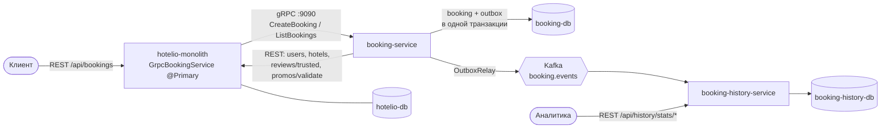

# Задание 2. booking-service и booking-history-service

Бронирование вынесено из монолита в отдельный сервис по паттерну Strangler Fig. Решение следует ADR-001 ([tasks/task1/results/ADR-001-migration-to-microservices.md](../../task1/results/ADR-001-migration-to-microservices.md)).

- Монолит по-прежнему принимает REST-запросы `/api/bookings`. Через встроенный прокси `GrpcBookingService` (библиотека `p-o-y`) он передаёт их в **booking-service** по gRPC.
- booking-service хранит брони в своей БД и публикует событие `BookingCreated` в Kafka.
- **booking-history-service** читает события и считает статистику, не обращаясь к боевой БД. В тексте задания он также называется `booking-statistics` — это один и тот же сервис.



## Компоненты

| Сервис | Технологии | Порты на хосте | Ответственность |
| :- | :- | :- | :- |
| `hotelio-monolith` | Java 17, Spring Boot | 8084 | REST-фасад. Создание брони и список по `userId` уходят в booking-service, всё остальное работает как раньше |
| `booking-service` | Java 17, Spring Boot 3.2, grpc-java 1.64, Spring Kafka, Flyway | 9090 (gRPC), 8085 (actuator) | Вся логика бронирования. Данные о пользователях, отелях, отзывах и промокодах берёт из монолита по REST |
| `booking-db` | PostgreSQL 15 | 5433 | `booking` и `outbox_event` |
| `booking-history-service` | Java 17, Spring Boot 3.2, Spring Kafka, JDBC, Flyway | 8086 | Журнал бронирований и агрегаты по пользователям, отелям и дням |
| `booking-history-db` | PostgreSQL 15 | 5434 | `booking_history`, `user_booking_stats`, `hotel_booking_stats`, `daily_booking_stats` |
| `kafka`, `zookeeper` | Confluent 7.2.1 | 9092, 2181 | Топик `booking.events` (3 партиции, ключ — `bookingId`) |
| `kafka-init` | одноразовый контейнер | — | Заранее создаёт топик. Иначе консьюмер может авто-создать его с одной партицией раньше продьюсера |

Все контейнеры работают во внешней сети `hotelio-net`.

## Запуск и проверка

```bash
docker network create hotelio-net   # если сети ещё нет
cd tasks/task2
docker compose up -d --build
./collect-results.sh                # прогон test/regress.sh и сбор артефактов в results/
```

Ручные вызовы:

```bash
# gRPC (reflection включён, .proto не нужен)
docker run --rm --network hotelio-net fullstorydev/grpcurl:v1.9.1 -plaintext -d '{}' booking-service:9090 booking.BookingService/ListBookings
# Статистика
curl localhost:8086/api/history/stats/summary   # а также /stats/users, /stats/hotels, /stats/days, /bookings?userId=
```

## booking-service

- **Контракт.** Используется общий `tasks/task2/booking.proto`: Gradle-задача `copyProtoContract` подкладывает его в сборку, копии в исходниках нет. Сервис реализует `CreateBooking` и `ListBookings`. Включён gRPC reflection.
- **Логика перенесена 1:1.** Тот же порядок проверок: пользователь активен → не в чёрном списке → отель работает → отелю можно доверять → отель не заполнен. Те же цены 100/80 и та же абсолютная скидка. Вместо 8 обращений, как в коде монолита, делается 4 REST-вызова: `GET /api/users/{id}`, `GET /api/hotels/{id}`, `GET /api/reviews/hotel/{id}/trusted`, `POST /api/promos/validate`. Таймаут 2 с.
- **Ошибки.** Отказ возвращается кодом `FAILED_PRECONDITION` с причиной. Прокси превращает его в исключение, и монолит, как и раньше, отвечает HTTP 500. Недоступность монолита — `UNAVAILABLE`, пустые `userId`/`hotelId` — `INVALID_ARGUMENT`.
- **Данные.**
  - Отдельная `booking-db`, схема управляется Flyway (`ddl-auto: validate`).
  - Собственные id начинаются с **10 000 000**, чтобы не пересекаться с id, перенесёнными из монолита.
  - `created_at` всегда заполнен (UTC).
- **События (transactional outbox).**
  - Бронь и `BookingCreated` пишутся в одной транзакции.
  - `OutboxRelay` раз в 500 мс забирает неопубликованные события (`FOR UPDATE SKIP LOCKED`, безопасно для нескольких реплик) и отправляет их в Kafka синхронно.
  - Продьюсер: `acks=all`, идемпотентный. Доставка at-least-once.

## booking-history-service

- **Подписка.** Consumer group `booking-history-service`, `auto-offset-reset: earliest`, JSON через `StringDeserializer` (без type-заголовков Spring, контракт — только JSON).
- **Идемпотентность.** Запись в `booking_history` делается через `INSERT … ON CONFLICT DO NOTHING` по `booking_id`/`event_id`. Агрегаты обновляются в той же транзакции и только если запись действительно вставлена. Повторная доставка события статистику не искажает.
- **Защита от битых сообщений.** Битое сообщение логируется и пропускается, чтобы не блокировать партицию.
- **REST API:**
  - `/api/history/bookings?userId=&hotelId=`
  - `/api/history/stats/users`
  - `/api/history/stats/hotels`
  - `/api/history/stats/days`
  - `/api/history/stats/summary`

## Что изменено в тестах

[`test/regress.sh`](../../../test/regress.sh) (копия — [regress.sh](regress.sh)):

1. **Подготовка.**
   - Проверяются подключения к трём БД.
   - Очищаются БД booking-service и history-service (только для тестового стенда).
   - Брони из фикстур монолита переносятся в booking-service скриптом [`test/migrate-bookings.sh`](../../../test/migrate-bookings.sh) (копия — [migrate-bookings.sh](migrate-bookings.sh)).
2. **«Все бронирования».** Проверка идёт через gRPC `ListBookings`, потому что через монолит запрос без `userId` падает в прокси (см. ограничение 1). Сам `GET /api/bookings` выводится как предупреждение ⚠️.
3. **Новые проверки бронирования:**
   - id новой брони ≥ 10 000 000, запись есть только в `booking-db`, а не в БД монолита;
   - VIP-цена 80, `createdAt` заполнен;
   - скидка по промокоду: 100 − 10 = 90;
   - прямые gRPC-вызовы: `FAILED_PRECONDITION` для неактивного пользователя, отказ для пользователя в чёрном списке, успешная бронь;
   - все события из outbox опубликованы.
4. **Новые проверки истории** (с ожиданием до 30 с, обработка асинхронная):
   - все 3 события дошли;
   - записи по id есть в `booking_history`;
   - REST-история пользователя;
   - статистика по пользователю, отелю и дню;
   - отклонённые брони в историю не попали.
5. **Образ тестов** (`test/Dockerfile`): добавлены `grpcurl` (из официального образа `fullstorydev/grpcurl`) и `jq`.

Запуск тестов вручную (тестовый контейнер — в сети `hotelio-net`):

```bash
docker build -t hotelio-tester test/
docker run --rm --network hotelio-net -e DB_HOST=hotelio-db -e DB_PORT=5432 -e DB_NAME=hotelio \
  -e DB_USER=hotelio -e DB_PASSWORD=hotelio -e API_URL=http://hotelio-monolith:8080 hotelio-tester
```

## Артефакты

| Файл | Содержимое |
| :- | :- |
| [docker-ps.txt](docker-ps.txt) | `docker ps` поднятого стека |
| [regress.sh](regress.sh), [migrate-bookings.sh](migrate-bookings.sh) | Доработанные тесты и скрипт переноса данных. `init-fixtures.sql` не менялся |
| [test-log.txt](test-log.txt) | Вывод регресса, ручные REST- и gRPC-запросы, статистика history-service, выдержки из логов сервисов |
| [bookings-select.txt](bookings-select.txt) | `select * from booking` из БД монолита и из `booking-db`, плюс `outbox_event` |
| [bookings-listing.txt](bookings-listing.txt) | Листинг бронирований через REST монолита и через gRPC `ListBookings` |
| [history-select.txt](history-select.txt) | `select *` из `booking_history` и таблиц агрегатов |
| [kafka-booking-events.txt](kafka-booking-events.txt) | Содержимое топика `booking.events`. В топике остаются события и прошлых прогонов тестов, поэтому их больше, чем записей в истории: тест очищает её БД перед запуском |

## Стратегия миграции данных при запуске нового сервиса

**Принципы:**
- **Один писатель.** После переключения брони пишет только booking-service.
- **Неперекрывающиеся диапазоны id.** В монолите id < 10 000 000, в booking-service id ≥ 10 000 000.
- **Перенос инкрементальный и идемпотентный.** Брони в монолите только добавляются (update/delete в коде нет).
- **Обязательная сверка** после каждого переноса.

**Порядок запуска в эксплуатацию:**

1. **Развернуть booking-service и booking-db** (Flyway создаёт схему). Трафик пока не переключён: у монолита нет `BOOKING_SERVICE_EXTERNAL_HOST`.
2. **Снимок.** `migrate-bookings.sh` копирует брони монолита (`id > последний перенесённый`, `id < 10 000 000`) из `hotelio-db` в `booking-db` через `\copy`. Попутно он:
   - заменяет пустой `created_at` (в монолите его не заполняли) временем переноса — прокси монолита не может разобрать пустую дату;
   - приводит пустой `promo_code` к `NULL`;
   - сверяет количество строк.
3. **Переключение.** Задать `BOOKING_SERVICE_EXTERNAL_HOST/PORT` и перезапустить экземпляры монолита. Создание брони и список по `userId` уходят в booking-service, монолит перестаёт писать в свою таблицу `booking`.
4. **Догоняющий перенос.** Повторно запустить `migrate-bookings.sh`: он докопирует брони, которые монолит успел записать между снимком и переключением. Диапазоны id не пересекаются, поэтому запуск безопасен в любой момент. Если экземпляров монолита несколько, перенос повторяется, пока переключены не все, и до совпадения сверки.
5. **Вывод legacy-таблицы.** Таблица `booking` в монолите становится read-only, а затем удаляется вместе с кодом бронирования (этап 5 ADR-001).

На тестовом стенде шаг 2 выполняет `regress.sh` сразу после загрузки фикстур. Монолит с `ddl-auto: create` пересоздаёт схему при каждом старте, поэтому данные в нём появляются только из фикстур.

**Что сознательно не реализовано в этом задании:**

- **Обратная синхронизация для отката** (этап 3 ADR-001). Если снять переменную окружения, монолит вернётся к своей таблице и не увидит брони, созданные в booking-service. План: потребитель `BookingCreated`, который дописывает брони в legacy-таблицу с теми же id, пока идёт период стабилизации.
- **История перенесённых броней.** Для них событий не было, поэтому статистика history-service начинается с момента переключения. Варианты бэкфилла:
  - при переносе публиковать через outbox `BookingCreated` с признаком `migrated: true`;
  - или сделать первичную загрузку history-service из снимка.

## Стратегия To-Be

Целевое состояние описано в ADR-001. Следующие шаги для бронирований:

1. **Убрать монолит из цепочки.** `/api/bookings`, включая список всех броней с пагинацией, маршрутизировать напрямую в booking-service через gateway или GraphQL booking-subgraph (задание 3). Удалить прокси `p-o-y`, `BookingService` и таблицу `booking` из монолита — заодно исчезнет NPE из ограничения 1.
2. **Отвязать booking-service от REST монолита.** Выносить по очереди Review → Hotel → Promo → User. ACL-адаптер переключается на gRPC новых сервисов, бизнес-код бронирования при этом не меняется. Затем перейти на локальные read-модели из событий (статус пользователя, отеля, репутация) и убрать синхронные проверки.
3. **Развивать события.**
   - Формальная схема: JSON Schema или Avro и Schema Registry.
   - Версионирование `eventType`.
   - Новые события, например `BookingCancelled`.
   - DLQ для history-service.
   - Политика retention для `booking.events`.
4. **Развивать аналитику.** history-service остаётся витриной оперативной статистики. Тяжёлую аналитику строить в DWH (например, ClickHouse) из того же топика, без нагрузки на сервисы.
5. **Платформа.**
   - Kafka минимум из 3 брокеров (KRaft), RF=3, `min.insync.replicas=2`.
   - Kubernetes и Helm (задание 4).
   - Istio (задание 5): canary, таймауты и ретраи. Таймауты особенно нужны, потому что прокси монолита не задаёт gRPC deadline.
   - Трассировка через gRPC и заголовки Kafka, метрики consumer lag.
