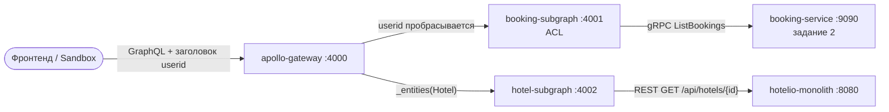

# Задание 3. Личный кабинет: GraphQL Federation — отчёт

Federated GraphQL API собран из двух подграфов и Apollo Gateway. Подграфы получают данные из реальных сервисов задания 2, а не из заглушек:

- **booking-subgraph** берёт бронирования из `booking-service` по gRPC (контракт `tasks/task2/booking.proto`);
- **hotel-subgraph** берёт отели из REST API монолита;
- **ACL** не даёт пользователю увидеть чужие бронирования. Проверка идёт на уровне запроса и на уровне сущности.



Все контейнеры работают в общей сети `hotelio-net` вместе со стеком задания 2.

## Что изменено

### booking-subgraph
- **Источник данных.** Заглушка заменена на gRPC-вызов `BookingService/ListBookings` (`@grpc/grpc-js`, `@grpc/proto-loader`).
  - Контракт не копируется: в образ его подкладывает `additional_contexts: contracts: ../task2` из `docker-compose.yml`.
  - У вызова deadline 2 с. Недоступность сервиса превращается в ошибку `BOOKING_SERVICE_UNAVAILABLE`.
- **Схема (Federation 2):**
  - `Booking @key(fields: "id")` с полями `id`, `userId`, `hotelId`, `promoCode`, `discountPercent`, плюс `price`, `createdAt` и `hotel: Hotel`;
  - `Hotel @key(fields: "id", resolvable: false)` — только ссылка, данные отеля резолвит hotel-subgraph;
  - `discountPercent` теперь `Float`, потому что в `booking.proto` это `double`;
  - пустой `promo_code` из proto3 отдаётся как `null`.
- **ACL** (подробнее ниже). Каждое решение пишется в лог строкой `userid=… requested=… decision=ALLOW|DENY`.
- **Канал к booking-service поднимается до старта сервера** (`waitForReady`). Без этого первый запрос после запуска контейнера падал с `Deadline exceeded … waiting for name resolution`: первый DNS-резолв в grpc-js съедал весь deadline. Теперь healthcheck подграфа отражает реальную готовность.

### hotel-subgraph
- **Источник данных.** Заглушки заменены на `GET /api/hotels/{id}` монолита (таймаут 2 с). `404` превращается в `null`, сетевые ошибки — в `HOTEL_SERVICE_UNAVAILABLE`.
- **`Hotel.__resolveReference({ id })`** разрешён по ID. Именно через него gateway достаёт `hotel { … }` внутри бронирования. `hotelsByIds` тоже работает.
- **DataLoader на запрос.** Одинаковые `hotelId` из разных броней загружаются одним вызовом.
- **Поля сверены с реальными данными монолита.** Добавлены `rating`, `description`, `operational`, `fullyBooked`. Поле `stars` убрано: такого поля в монолите нет, есть `rating`.
- **`name`.** У отеля в монолите нет поля `name` — это расхождение документации и кода, ADR-001, П-16. Поэтому `name` берётся из `hotel.name`, а если его нет — из `description`. Имена я не выдумывал. Когда в hotel-service появится настоящее `name`, оно подхватится без изменений схемы.

### apollo-gateway
Задание говорит, что гейтвей «менять не надо, если сервисы работают». Проверка показала, что без правки ACL не работает: Apollo Gateway **не передаёт клиентские заголовки в подграфы** по умолчанию, вопреки подсказке. Запрос с `userid: user1` через исходный gateway дошёл до подграфа без заголовка:

```
[booking-subgraph] bookingsByUser userid=<absent> requested=user1 decision=DENY reason=missing userid header
```

Тот же запрос напрямую в подграф прошёл (`decision=ALLOW bookings=2`). Изменения минимальные:
- `buildService` с `RemoteGraphQLDataSource.willSendRequest` копирует заголовок `userid` из входящего запроса в запросы к подграфам. Список передаваемых заголовков задан явно (`FORWARDED_HEADERS`), чтобы не пробрасывать всё подряд;
- `includeStacktraceInErrorResponses: false`: stacktrace больше не утекает клиенту в ошибках, то же сделано в подграфах;
- `serviceList` оставлен, хотя он deprecated (предупреждение в логе): он работает, а задание просит не трогать рабочее.

### docker-compose.yml
- **Сеть.** Все сервисы подключены к внешней сети `hotelio-net`, где работают `booking-service` и `hotelio-monolith` из задания 2.
- **Healthchecks подграфов** (POST `{__typename}`). Gateway стартует только после них (`depends_on: service_healthy`), иначе он падает при сборке суперграфа.
- **Адреса зависимостей** задаются через переменные `BOOKING_GRPC_ADDR` и `MONOLITH_URL`. Контейнерам даны имена.

### seed-demo.sh (новый)
- Создаёт пользователей `user1` и `user2`, а также ещё один «надёжный» отель `demo-hotel-busan` с 10 отзывами.
- Бронирования создаёт **через REST монолита**, то есть настоящим путём монолит → gRPC → booking-service → Kafka. Поэтому запрос из задания с `userId: "user1"` возвращает данные буквально.
- Скрипт идемпотентен. Перезапускать его нужно после `test/regress.sh` и после рестарта монолита.

## ACL

Пока нет полноценного API Gateway с JWT, пользователя определяет заголовок `userid`.

| Уровень | Где | Правило | Ответ |
| :- | :- | :- | :- |
| Запрос | `Query.bookingsByUser(userId)` | Заголовка `userid` нет | Ошибка `UNAUTHENTICATED`, `bookingsByUser: null` |
| Запрос | `Query.bookingsByUser(userId)` | `userid ≠ userId`: запрос чужих бронирований | Ошибка `FORBIDDEN`, `bookingsByUser: null` |
| Запрос | `Query.bookingsByUser(userId)` | `userid = userId` | Бронирования. Дополнительно они фильтруются по владельцу (defense in depth) |
| Сущность | `Booking.__resolveReference({ id })` | Бронь отдаётся, только если принадлежит пользователю из `userid` | Иначе `null` |

Проверка на уровне сущности закрывает обходной путь: если другой подграф сошлётся на `Booking` по `id`, чужую бронь через `_entities` всё равно не получить (см. пункт 4 в [curl-checks.txt](curl-checks.txt)).

**Ограничение.** Заголовку `userid` сейчас верят на слово, подделать его может любой клиент. В целевой архитектуре (ADR-001) личность устанавливает API Gateway. Он проверяет JWT от Identity Provider и сам выставляет `userid` или claim для подграфов, а клиентский заголовок отбрасывает. Резолверы подграфа при этом не меняются.

## Запуск и проверка

```bash
# 1. Стек задания 2 (booking-service, монолит, Kafka) — в сети hotelio-net
cd tasks/task2 && docker compose up -d --build
# 2. Демо-данные: user1, user2 и их бронирования
cd ../task3 && ./seed-demo.sh
# 3. Federation
docker compose up -d --build
```

Откройте http://localhost:4000/ (Apollo Sandbox), добавьте заголовок `userid: user1` и выполните запрос из задания:

```graphql
query {
  bookingsByUser(userId: "user1") {
    id
    hotel {
      name
      city
    }
    discountPercent
  }
}
```

С заголовком `userid: user2` или без него вернётся отказ ACL.

## Артефакты

| Файл | Содержимое |
| :- | :- |
| [screenshot-success.png](screenshot-success.png) | Успешный вызов в Apollo Sandbox: `userid: user1`, 2 бронирования с отелями из hotel-subgraph |
| [screenshot-deny-acl.png](screenshot-deny-acl.png) | Deny по ACL: `userid: user2` запрашивает брони `user1` → `FORBIDDEN` |
| [screenshot-deny-unauthenticated.png](screenshot-deny-unauthenticated.png) | Deny без заголовка `userid` → `UNAUTHENTICATED` |
| [booking-subgraph.log](booking-subgraph.log) | Лог booking-subgraph после двух запросов со скриншотов: `ALLOW`, затем `DENY` |
| [docker-compose-logs.txt](docker-compose-logs.txt) | Логи всех контейнеров task3 (gateway, оба подграфа), включая третий запрос без заголовка |
| [docker-ps.txt](docker-ps.txt) | `docker ps`: task3 и стек задания 2. Посторонние контейнеры других проектов исключены |
| [curl-checks.txt](curl-checks.txt) | Те же сценарии через curl, ACL сущности через `_entities`, `hotelsByIds` с неизвестным id |

Скриншоты сняты в настоящем Apollo Sandbox на http://localhost:4000/. Headless Chrome (puppeteer-core) вводил запрос и заголовок и нажимал Run, ответы — реальные ответы gateway.
