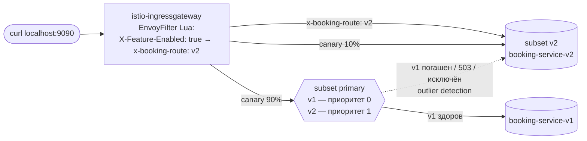

# Задание 5. Управление трафиком с Istio — отчёт

`booking-service` из задания 4 работает в Istio Service Mesh двумя версиями. Трафик между ними управляется без изменений бизнес-кода:

- **canary** 90/10;
- **fallback** v1 → v2, если v1 недоступен или отвечает ошибками;
- **retry** и **circuit breaking**;
- **feature flag** через EnvoyFilter по заголовку `X-Feature-Enabled: true`.

Все четыре проверочных скрипта проходят.

Окружение: Minikube 1.39 (Kubernetes 1.37), Istio 1.31.3, профиль `demo`.



## 1. Копия task4 и две версии сервиса

`tasks/task5` — копия `tasks/task4` (сервис, Dockerfile, Helm-чарт, пайплайн, скрипты) с доработками ниже.

**Сервис** ([booking-service/app.go](../booking-service/app.go)), тот же образ для обеих версий:
- **Версия в ответе.** Каждый ответ содержит `X-App-Version` (`v1`/`v2`) — по нему скрипты считают распределение.
- **Фича по заголовку.** При `FEATURE_FLAGS_FROM_HEADER=true` (только v2) фича X включается на отдельный запрос заголовком `X-Feature-Enabled: true`: `/feature` → 200 `Feature X is enabled! (version v2)`. Без заголовка, а также в v1 — 404.
- **Режим сбоя для проверки fallback.** При `CHAOS_ENABLED=true` есть эндпоинт `POST /chaos/fail|recover`. В режиме сбоя под отвечает 503 на трафик, пришедший через Envoy. Пробы kubelet идут мимо Envoy и продолжают проходить, поэтому под не перезапускается.
  - Сам эндпоинт доступен **только изнутри пода** (`kubectl exec`). Запрос через gateway или sidecar получает 403, так что положить сервис снаружи нельзя.
- **Unit-тесты:** 10 (было 7), добавлены тесты заголовков, фичи по заголовку и chaos-режима.

**Helm.** Один чарт, два релиза: `booking-service-v1` и `booking-service-v2`.
- Deployment `booking-service-<version>` с метками `app=booking-service`, `version=<version>` — по ним Istio строит subsets.
- Общий Service `booking-service` выбирает поды по `app` и создаётся только релизом v1 (`service.create`).
- Порт называется `http` — подсказка Istio о протоколе.

| | [values-v1.yaml](values-v1.yaml) | [values-v2.yaml](values-v2.yaml) |
| :- | :- | :- |
| Роль | Основная версия | Новая (canary), fallback для v1 |
| `version` / `APP_VERSION` | `v1` | `v2` |
| `FEATURE_FLAGS_FROM_HEADER` | `false` | `true` |
| `service.create` | `true` | `false` |
| `CHAOS_ENABLED` | `true` | `true` |

**Пайплайн** (`.gitlab-ci.yml`) в джобе `deploy` ставит оба релиза и применяет `istio/` (`kubectl apply`). Прогон `npx gitlab-ci-local build unit-test test deploy` прошёл ([pipeline-log.txt](pipeline-log.txt)). Джоб `tag` не запускался, чтобы не плодить теги на незакоммиченном коде.

## 2. Установка Istio

```bash
brew install istioctl                        # Istio 1.31.3
istioctl x precheck
istioctl install --set profile=demo -y       # istiod, ingress- и egress-gateway
kubectl label namespace default istio-injection=enabled --overwrite
```

Поды booking-service — `2/2`: приложение и `istio-proxy` (см. [check-istio.log](check-istio.log)). `istioctl analyze` замечаний не находит.

## 3. Маршрутизация: canary, fallback, feature flag

[virtual-service.yaml](virtual-service.yaml) содержит Gateway `booking-gateway` (порт 80) и VirtualService с двумя HTTP-маршрутами. Порядок важен:

1. **`feature-flag-v2`.** При `x-booking-route: v2` запрос идёт в subset `v2`. Этот внутренний заголовок выставляет EnvoyFilter (раздел 5).
2. **`canary`.** Весовой маршрут: **90% в subset `primary`, 10% в subset `v2`.**

**Fallback v1 → v2.** Сам VirtualService не умеет «при ошибке v1 отправить в v2»: разные subsets — это разные кластеры Envoy. Поэтому fallback собран из двух механизмов.

- **Приоритеты внутри subset `primary`** ([destination-rule.yaml](destination-rule.yaml)):
  - subset включает поды обеих версий (`app: booking-service`), но через `localityLbSetting.failoverPriority: ["version=v1"]` поды v1 получают приоритет 0, остальные — приоритет 1. В Envoy это подтверждено: v1 `priority=0`, v2 `priority=1` ([istio-config-evidence.txt](istio-config-evidence.txt));
  - пока v1 здоров, весь трафик `primary` идёт в v1;
  - если подов v1 нет или outlier detection их исключил, Envoy переводит трафик на приоритет 1, то есть на v2.
- **Retry в другой приоритет.** У маршрута `canary` задан `retryRemoteLocalities: true`. Envoy включает `envoy.retry_priorities.previous_priorities`, и повтор неудачного запроса уходит на следующий приоритет. Ошибка v1 сразу подменяется ответом v2, клиент её не видит.

Итог: 90% трафика попадает в v1, пока он здоров, и автоматически в v2, если v1 сломан. Канареечные 10% всегда идут в v2.

## 4. Retry и Circuit Breaking

[destination-rule.yaml](destination-rule.yaml):

- **Circuit breaker по ресурсам** (`connectionPool`):
  - `maxConnections: 100`, `http1MaxPendingRequests: 50`, `http2MaxRequests: 100`, `connectTimeout: 2s`;
  - сверх лимитов Envoy сразу отвечает 503 (overflow) и не нагружает сервис;
  - пороги видны в Envoy: `max_connections::100`, `max_pending_requests::50`, `max_requests::100`.
- **Circuit breaker по ошибкам** (`outlierDetection`):
  - под с 3 ответами 5xx подряд (или 3 gateway-ошибками) исключается на `baseEjectionTime: 30s`, срок растёт при повторных исключениях;
  - `maxEjectionPercent: 100`;
  - `minHealthPercent: 0` отключает panic mode, чтобы исключённый под действительно не получал трафик.
- **Бюджет повторов.** `maxRetries: 3` — не больше 3 одновременных повторов на кластер, защита от retry storm (`max_retries::3`).
- **Сами повторы.** В Istio они задаются **в VirtualService**: у DestinationRule нет полей `attempts`/`retryOn`, только бюджет `maxRetries`. В обоих маршрутах `attempts: 3`, `perTryTimeout: 2s`, `retryOn: 5xx,gateway-error,connect-failure,refused-stream,reset`, общий `timeout: 10s`.

## 5. Feature flag через EnvoyFilter

[envoy-filter.yaml](envoy-filter.yaml) — Lua-фильтр в ingress gateway (`context: GATEWAY`), вставлен перед `envoy.filters.http.router`:

1. Удаляет клиентский `x-booking-route`, так что подделать маршрут снаружи нельзя (проверено: с поддельным заголовком работает обычный canary).
2. Если `X-Feature-Enabled` равен `true` (без учёта регистра), добавляет `x-booking-route: v2`.
3. Вызывает `clearRouteCache()`: маршрут мог быть выбран до фильтра, и его нужно пересчитать с новым заголовком.
4. В ответ добавляет `x-feature-flag-filter: applied` — видно, что фильтр сработал.

Разделение ответственности:
- EnvoyFilter **решает**, включён ли флаг. Сюда можно добавить другие источники: cookie, query, процент пользователей.
- VirtualService **маршрутизирует** по `x-booking-route`.
- Сервис v2 **включает фичу** по тому же `X-Feature-Enabled`.

## 6. Проверочные скрипты и результаты

Скрипты доработаны:
- при необходимости сами поднимают `kubectl port-forward -n istio-system svc/istio-ingressgateway 9090:80`;
- считают версии по `X-App-Version`;
- печатают `[PASS]`/`[FAIL]` и выходят с ненулевым кодом при ошибке.

Общие функции — в [scripts/istio-lib.sh](../scripts/istio-lib.sh).

| Скрипт | Что проверяет | Результат |
| :- | :- | :- |
| [check-istio.log](check-istio.log) | Поды istio-system, `istioctl version`, метка `istio-injection=enabled`, `istio-proxy` в каждом поде booking-service, Istio-ресурсы, `proxy-status` | 3 PASS |
| [check-canary.log](check-canary.log) | 100 запросов `/ping`: **v1 — 91, v2 — 9, ошибок 0** (по `X-App-Version`). Access-лог gateway за последние 100 записей: 90 → `primary`, 10 → `v2`. Расхождение в один запрос — из-за задержки записи access-лога | PASS (допуск 10% ± 7%) |
| [check-feature-flag.log](check-feature-flag.log) | 20 запросов с `X-Feature-Enabled: true` — все v2. `/feature` с флагом — 200 от v2. Без флага — 20 × 404. Поддельный `x-booking-route` игнорируется | 5 PASS |
| [check-fallback.log](check-fallback.log) | **Сценарий 1** — под v1 погашен (`scale --replicas=0`): 30/30 ответов от v2. **Сценарий 2** — v1 отвечает 503 (`/chaos/fail`): клиент получил 30/30 успешных ответов от v2. В логе sidecar v1 ровно 3 ответа 503 (порог outlier detection), каждый переотправлен retry в v2. Хост v1 в gateway помечен `failed_outlier_check`. После `/chaos/recover` и окончания исключения v1 снова получает трафик | 5 PASS |

Дополнительно [check-dns.log](check-dns.log): service discovery из задания 4 работает и в mesh (`http://booking-service/ping` → `pong`).
- Тестовому поду отключена инъекция sidecar: иначе `kubectl run --rm -i` не завершается, пока работает `istio-proxy`.
- Он ходит в под с sidecar по plaintext, и это работает: mTLS по умолчанию в режиме PERMISSIVE.

[istio-config-evidence.txt](istio-config-evidence.txt) — фактическая конфигурация Envoy в ingress gateway:
- приоритеты endpoints subset `primary`;
- retry-политика маршрутов с `previous_priorities` и веса 90/10;
- пороги circuit breaker;
- выдержка access-лога.

Скрипты нужно запускать в порядке `check-istio` → `check-canary` → `check-feature-flag` → `check-fallback`. После chaos-сценария v1 до 30 с исключён outlier detection, и canary в это время показал бы почти 0/100. Сам `check-fallback.sh` в конце восстанавливает состояние и ждёт возврата v1.

## Ограничения и решения

- **VirtualService привязан только к ingress gateway** (`hosts: "*"`, `gateways: [booking-gateway]`). На нём проверяются все скрипты. Клиенты внутри mesh, обращающиеся к `booking-service` по DNS, получают политики DestinationRule (circuit breaking, mTLS), но не разбивку 90/10. Для этого нужен второй VirtualService с `gateways: [mesh]` и `hosts: [booking-service]` с теми же маршрутами.
- **Распределение canary вероятностное.** На 100 запросах получается около 90 ± 3 к 10 ± 3, поэтому в скрипте заложен допуск.
- **EnvoyFilter — низкоуровневый API.** `istioctl validate` предупреждает, что он зависит от внутренних деталей Envoy и требует проверки при обновлениях Istio. Это осознанный выбор, потому что задание прямо требует EnvoyFilter.
- **Ресурсы.** Стенд работает на Minikube с 2,2 ГБ памяти. Обе версии — по одной реплике, и под v1 именно поэтому «гасится» полностью, что и показывает fallback.
